# LakeBoard

**Dashboards on the lakehouse.**

LakeBoard is one Databricks App that hosts many dashboards. Each dashboard is a plain folder under
`src/dashboards/`: a small manifest, a few SQL files and one HTML page. Folders are reviewed by pull request and
deployed to dev, test and prod like any other code. That makes it a practical way to retire Power BI reports one
folder at a time. Claude Code, Codex and other coding agents can write a whole dashboard against the same
documented contract. Queries run as the person viewing the page. Per-viewer caching preserves Unity Catalog row
filters and column masks; opt-in shared caching checks reader access and requires identical results for every
permitted viewer. Every page shows how fresh its data is, and a dashboard can add an "Ask Genie" bar that answers
questions with the viewer's own access.

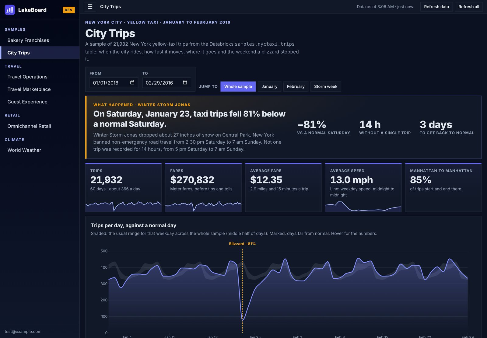

## From Power BI to LakeBoard

For Power BI migrations, the intended end-to-end architecture shares reviewed business metrics between
dashboards and natural-language analytics:

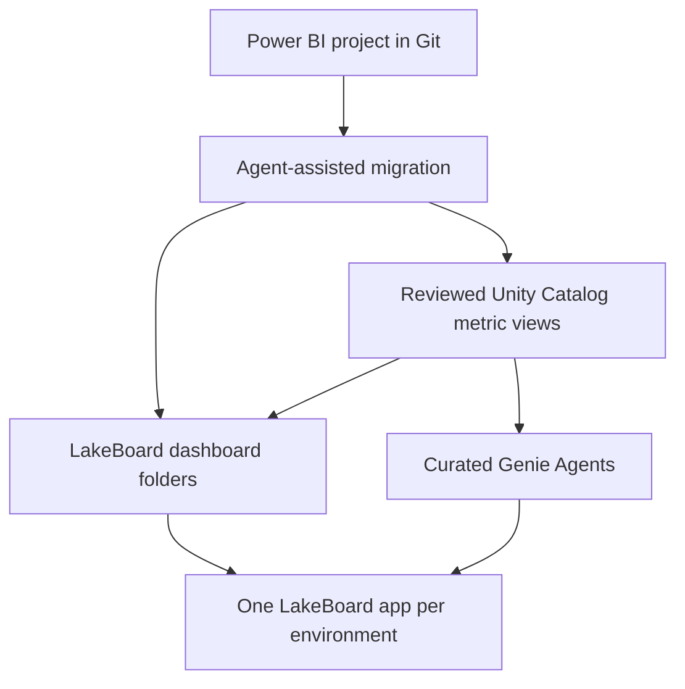

Metric views and Genie Agents are reviewed and provisioned separately. LakeBoard currently scaffolds and
validates dashboard folders and connects them to existing Genie Agents; automatic semantic-model conversion
and provisioning are not included in this repository. Follow the [migration guide](docs/MIGRATION.md) to map
and reconcile an existing report. New dashboards can start directly from approved Databricks data using the
[shared authoring workflow](docs/DASHBOARD_WORKFLOW.md).

## Quickstart (about 10 minutes)

This runs the sample dashboards, which read only the built-in `samples` catalog. `samples` exists in most
Unity Catalog workspaces (an admin can hide it). [Databricks Free Edition](https://www.databricks.com/learn/free-edition)
works well: it has a serverless starter warehouse, Databricks Apps and the `samples` catalog.

| Sample | Reads | Shows |
|---|---|---|
| [City Trips](src/dashboards/city-trips/) | `samples.nyctaxi` | Taxi trips by day and hour, busy ZIP codes, fares by distance |
| [Sales & Margin](src/dashboards/sales-margin/) | `samples.tpch` | Revenue, discount and margin, year on year |
| [Bakery Franchises](src/dashboards/bakery-franchises/) | `samples.bakehouse` | Franchise sales, products and reviews, on a map |
| [Travel Operations](src/dashboards/travel-operations/) | `samples.wanderbricks` | Executive overview, saved destinations, property drill-down, guest experience and TV view |
| [Travel Marketplace](src/dashboards/travel-marketplace/) | `samples.wanderbricks` | Bookings, revenue and seasonality across 42 destinations, drilling down to each property on a map |
| [Guest Experience](src/dashboards/guest-experience/) | `samples.wanderbricks` | Reviews and support chats: ratings, topics, how the guest's mood changes, agents |
| [Omnichannel Retail](src/dashboards/omnichannel-retail/) | `samples.tpcds_sf1` | Store, catalog and web sales year on year, the holiday peak, hours, returns |
| [World Weather](src/dashboards/world-weather/) | `samples.accuweather` | Observed weather and a 15-day forecast for 50 cities, on a temperature map |

<p>
  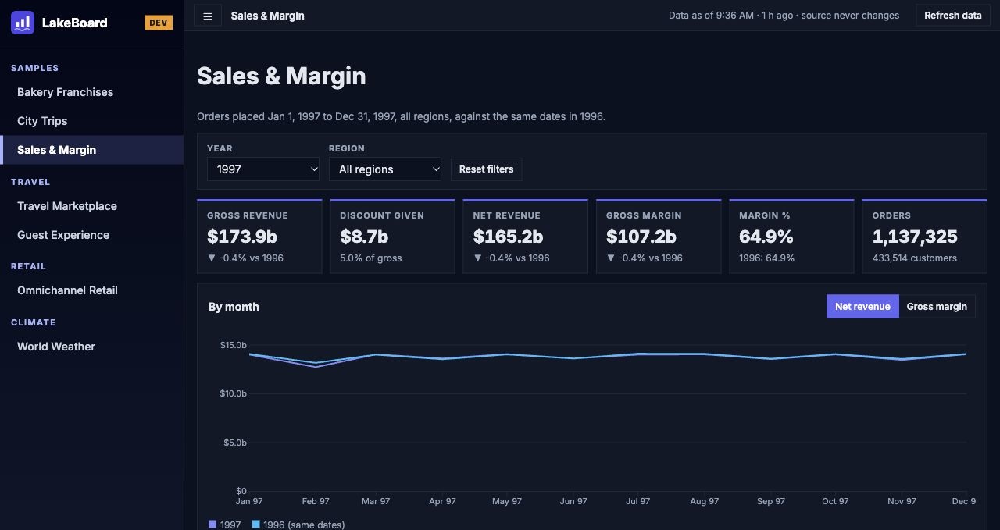
  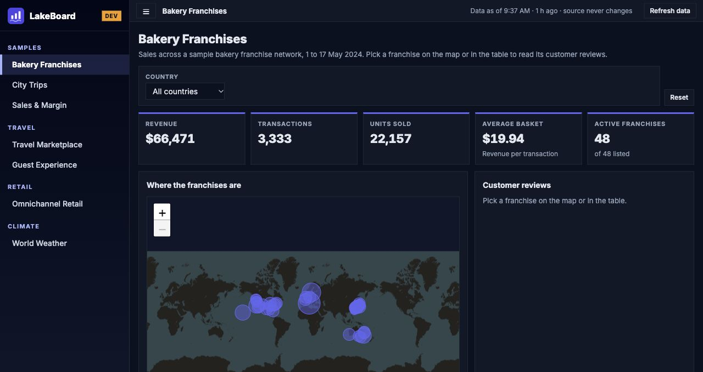
</p>
<p>
  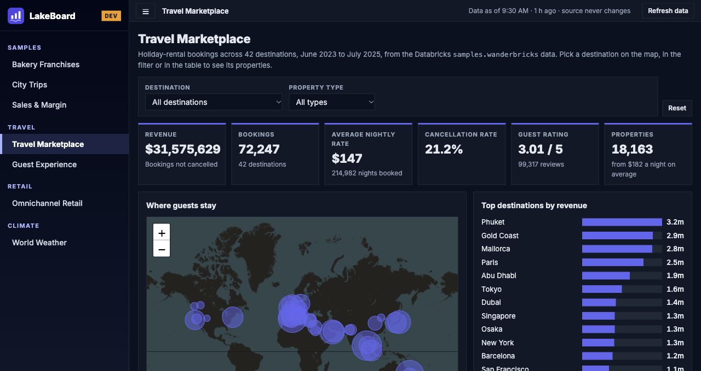
  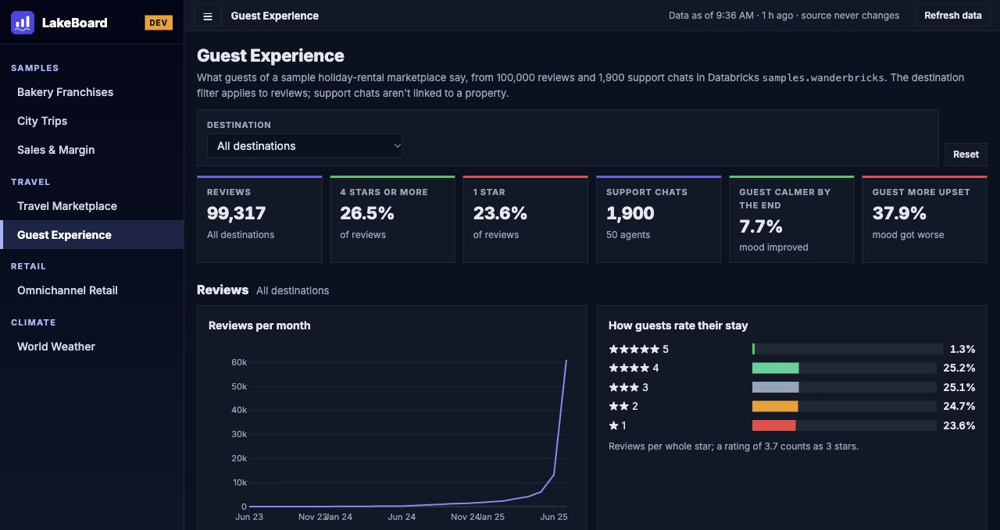
  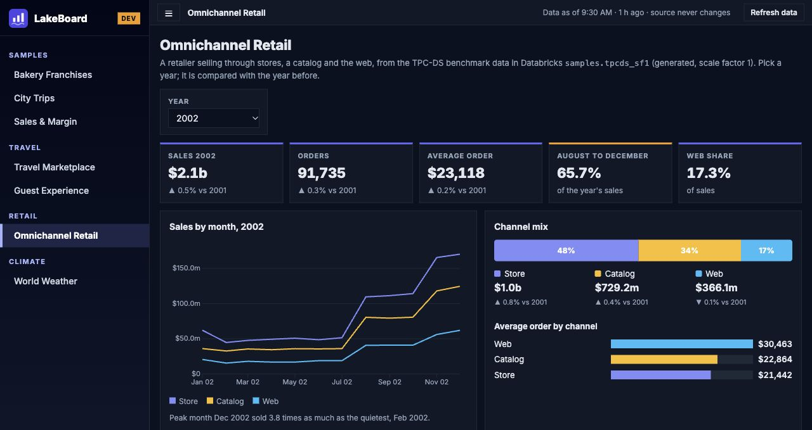
  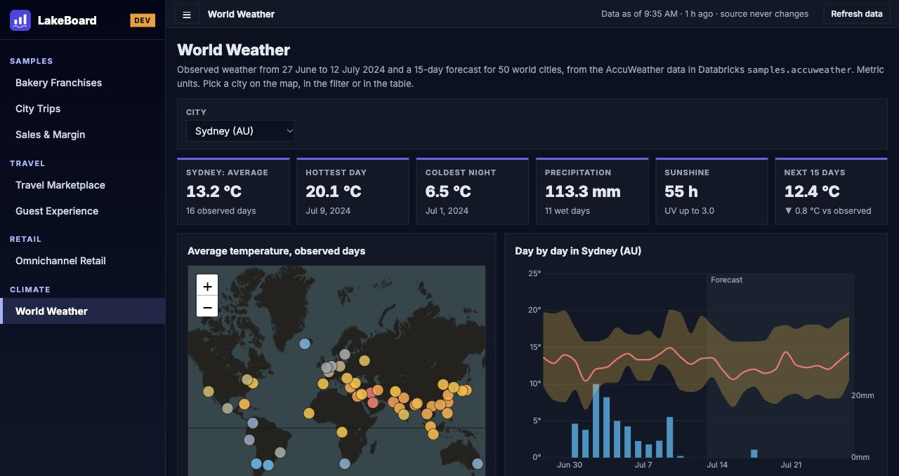
</p>

**1. Sign in with the Databricks CLI** (a recent version; `databricks --version`):

```bash
databricks auth login --host https://<your-workspace-host> --profile <cli-profile>
```

**2. Install and run locally.** You need Python 3.11 or later and a SQL warehouse id (SQL Warehouses > your
warehouse > Connection details; on Free Edition, the Serverless Starter Warehouse).

```bash
pip install -r src/requirements.txt fastapi uvicorn pytest httpx
./scripts/run_local.sh <cli-profile> <warehouse-id>
# Windows: ./scripts/run_local.ps1 -Profile <cli-profile> -Warehouse <warehouse-id>
```

Open http://localhost:8000. You are signed in as your CLI profile, and the queries run as you.

**3. Deploy to your workspace.** In `databricks.yml`, set the `dev` target's `host` and `warehouse_id`, and set
`viewers_group` to a group you are in (or `users`). Set the same host for `dev` in `src/environments.yml`. Then:

```bash
databricks bundle deploy -t dev -p <cli-profile>
databricks bundle run portal -t dev -p <cli-profile>
```

The second command prints the app URL. Stop the app when you are done (`databricks apps stop lakeboard-dev
-p <cli-profile>`) so it doesn't use compute.

**Keep your workspace out of git** (optional, handy for a public fork): leave the placeholders and put your values in
two gitignored files instead. `databricks.local.yml` overrides the target:

```yaml
targets:
  dev:
    workspace: {host: https://<your-workspace-host>}
    variables: {warehouse_id: "<warehouse-id>", viewers_group: users}
```

and `src/environments.local.yml` sets the host the app uses to know it is dev:
`environments: {dev: {host: <your-workspace-host>}}` (no https://).

The GitHub Actions deploy does this for you: it writes both files from the `DATABRICKS_HOST` and
`DATABRICKS_WAREHOUSE_ID` variables of the GitHub environment, so a workspace never has to be committed
([docs/PROMOTION.md](docs/PROMOTION.md)).

**4. Add your own dashboard:**

```bash
python scripts/new_dashboard.py my-dashboard "My dashboard" --owner Finance --section Finance
python scripts/check.py --static && python -m pytest -q
```

Add your catalogs under `catalogs:` in `src/environments.yml`, then follow [docs/AUTHORING.md](docs/AUTHORING.md).
To hide the samples, delete their folders or set `environments: [dev]` in their `dashboard.yml`.

## Create dashboards with your coding agent

Open this repository in Claude Code, Codex, Cursor or another coding tool. The shared instructions are in
[AGENTS.md](AGENTS.md) and [docs/DASHBOARD_WORKFLOW.md](docs/DASHBOARD_WORKFLOW.md). Claude Code's
`CLAUDE.md` and `new-dashboard` skill point to those same instructions. Codex reads `AGENTS.md`; for another
tool, explicitly ask it to read that file if it does not discover repository instructions itself.

For example:

```text
Read AGENTS.md and follow docs/DASHBOARD_WORKFLOW.md to build a LakeBoard dashboard.
Use docs/AUTHORING.md for the APIs and City Trips as the example.
The dashboard should answer [question] for [audience], using [approved data].
The owning team is [team], the section is [section], and allowed viewers are [groups].
Use connected Databricks Genie One MCP tools, if available, to clarify sources and metric definitions.
Return the dashboard folder, validation results and anything still unverified.
```

Business users can describe a dashboard to their agent, explore approved data through Databricks Genie One MCP,
and hand the generated folder to the data team for review and hosting. See [Build your own dashboard](docs/BUSINESS_AUTHORS.md)
for the brief and handoff. No separate app is needed for each report.

The hosting format is a manifest, SQL and HTML/CSS/JavaScript using LakeBoard's `dash` and `kit` APIs. Direct
repository authoring is the simplest route; other tools' previews can be adapted to that contract. Serving the
dashboard does not require the agent or model that authored it. Databricks Genie One MCP is used during authoring;
the optional in-dashboard Ask Genie integration uses a curated Genie agent and is configured separately.

## Features

- **One app, many dashboards.** One Databricks App (FastAPI) and one deploy, a left navigation with sections, and a
  home page of tiles. A new dashboard costs a folder, not another app.
- **Queries run as the viewer** through Databricks Apps user authorization, so Unity Catalog decides what each person
  sees. Dashboards and single datasets can also be limited to workspace groups.
- **Safe SQL by construction.** One read-only `SELECT`/`WITH` per file, typed `:name` parameters, an allow-list of
  catalogs, and a check that runs on every pull request.
- **Dev, test and prod from one branch flow.** SQL is written with prod catalog names and swapped per environment
  (`src/environments.yml`). Example pipelines for GitHub Actions and Azure DevOps.
- **Caching that fits the data.** Per-viewer or shared results, reader access checks before shared results, a
  time-to-live per dataset, startup-only or scheduled warming, and explicit app-auth datasets.
- **Freshness label.** "Data as of 10:42 am" in the title bar, with a panel showing how each dataset is cached and
  whether the source tables have changed since (from Unity Catalog metadata).
- **Ask Genie** about a dashboard, with the page's filters sent as context. Answers show the table and the SQL.
- **A page kit** (`kit`): filters, KPI tiles, sortable tables with CSV and Excel export, bars, lines, maps, number
  formats. Light and dark themes from one block of CSS variables; the name, logo and locale are configuration.
- **Strict browser sandbox.** A Content-Security-Policy keeps pages from loading or sending anything to other sites. Pages can be framed by the app itself and by the workspace (`DATABRICKS_HOST`). Add further https origins, space- or comma-separated, in `FRAME_ANCESTORS` (each must be `https://host` or `https://host:port`, with no path or wildcard). A bad `DATABRICKS_HOST` or `FRAME_ANCESTORS` entry stops the app at start-up. `X-Frame-Options: SAMEORIGIN` is sent only when no other origin is allowed.
- **Migration helpers.** A Power BI usage report (who views what) to plan the order of work, and a README template
  for recording how each dashboard reconciles with the report it replaces.
- **Power BI projects to dashboards.** Point Claude Code at a Power BI project in git (PBIP): `scripts/pbip_summary.py`
  lists its tables, sources, DAX measures (flagging the ones that need care), relationships, RLS and visuals, and the
  `migrate-power-bi` skill turns that into a dashboard folder and proves the numbers match.
- **Host Claude dashboards.** A business user builds a dashboard in Claude and shares it. The `import-claude-dashboard`
  skill turns it into a draft here with its page unchanged (`page: artifact`), recovers or stubs the SQL behind each
  dataset, and checks it against the user's snapshot before it goes live. Drafts are visible only to the data team
  and the groups you choose.

### Two ways in

| Route | Who | How |
|---|---|---|
| Migrate a Power BI report | Data team | Claude Code reads the Power BI project and writes the dashboard folder directly ([docs/MIGRATION.md](docs/MIGRATION.md)) |
| Host a dashboard built in Claude | Business users, then the data team | Share the Claude dashboard; Claude Code imports it as a draft, wires its data to Unity Catalog and reconciles it ([docs/AUTHORING.md](docs/AUTHORING.md)) |

## Travel Operations showcase

[Travel Operations](src/dashboards/travel-operations/) brings the public Wanderbricks sample together as an
operating view: executive overview, saved destinations, property drill-down and guest experience. Built by
Doneel Maran, it demonstrates one dashboard folder with keyboard navigation, light/dark themes and a TV view.
The 2025 sample is historical and partial; booked value is not recognized revenue.

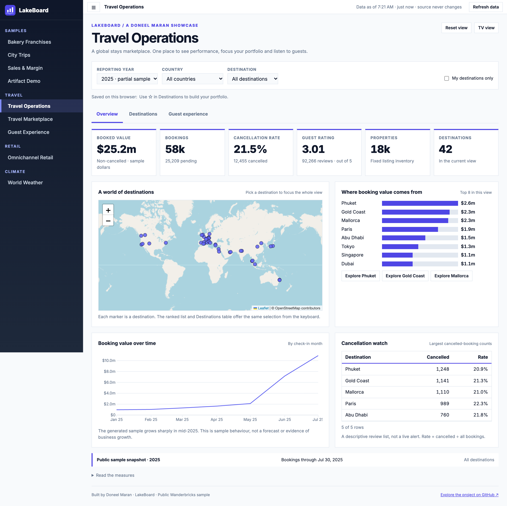

<details>
<summary>TV view and guest experience</summary>

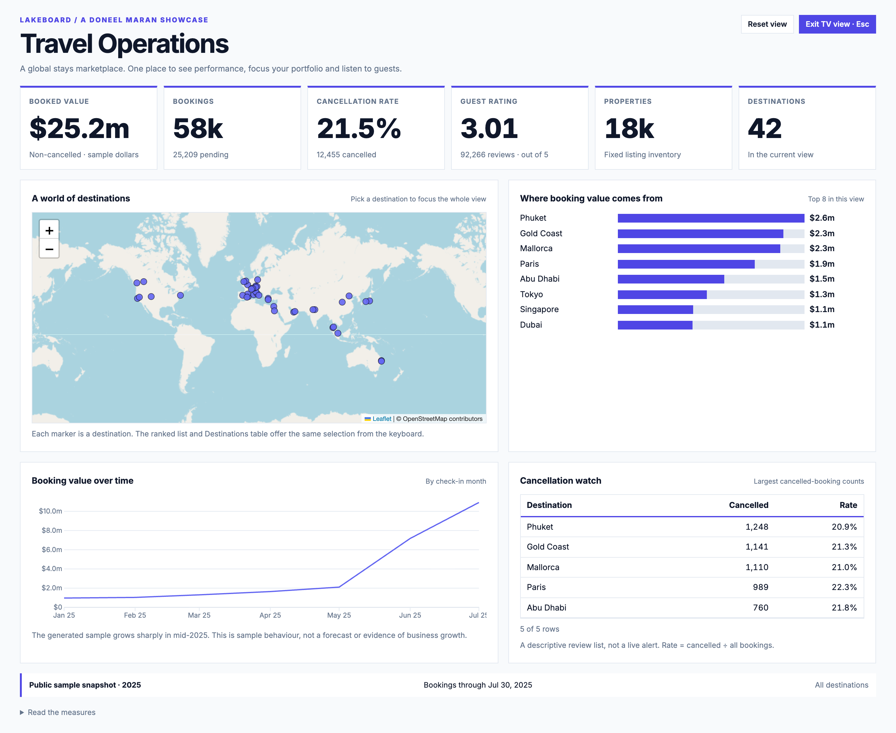

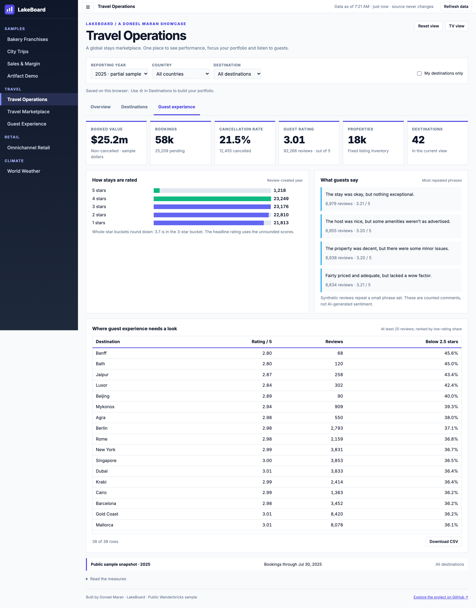

</details>

## Data freshness

Click **Data as of …** beside **Refresh data** to see when each dataset was fetched, when its cached copy
expires, how it is shared, and what is known about its source tables. In this example, the built-in sample data
never changes, so the panel explains why refreshing would return the same data.

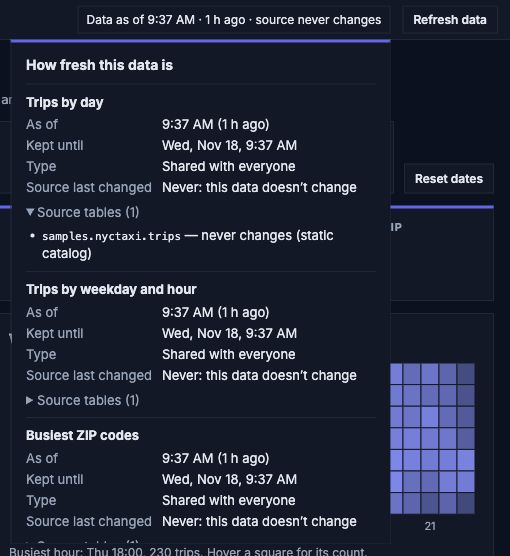

## Phone layout

The same City Trips dashboard at a 390 × 844 browser viewport: the navigation collapses into a drawer,
KPI tiles wrap into two columns, and charts stack below the filters.

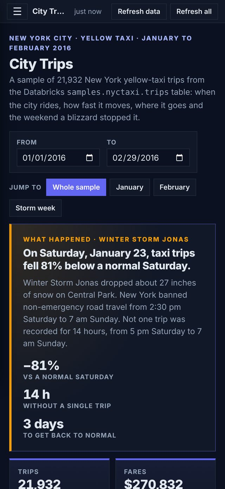

This is a phone-width browser preview. Databricks also documents access to Databricks Apps through the
[Genie mobile app](https://docs.databricks.com/aws/en/genie-one/mobile); testing LakeBoard inside that native
app is separate from the responsive layout shown here.

## Why not AI/BI dashboards, Streamlit or Evidence?

They are all good tools, and often the better choice.

- **Databricks AI/BI dashboards** need no code and are built in. Use them when their widgets and layouts are enough.
  LakeBoard is for pages they can't express (custom layouts, maps with routes, drill-downs, printable exports), and
  for teams who want dashboards as reviewed files in git that an agent can write end to end.
- **Streamlit** (or Dash) is Python and great for interactive tools. It is usually one app per dashboard, each with its
  own compute, and every interaction reruns the script on the server. LakeBoard runs one app for all dashboards and
  draws in the browser.
- **Evidence** builds static pages from Markdown and SQL, with the data captured at build time. LakeBoard queries live,
  as each viewer when data is fetched. Cached results follow their configured TTL and access policy.

The cost of LakeBoard: pages are HTML and JavaScript (or an AI agent writes them), and you own a small platform.

## Limitations

- Databricks only. It needs Databricks Apps and a SQL warehouse, and user authorization for apps must be turned on in
  the workspace (a workspace admin setting).
- Rows reach the browser as strings and are capped (500,000 by default), so aggregate in SQL.
- Caches live in the app's memory: they are lost on restart and not shared between app instances.
- No scheduled emails, subscriptions or alerts; no drag-and-drop editing. Authors write HTML or ask an agent to.
- Ask Genie needs a Genie space you set up; the portal does not create one.
- The freshness label relies on Unity Catalog metadata. External and federated tables have no reliable change time,
  so it says so instead of guessing.
- Background warming and `auth: app` datasets run as the app's service principal, which needs grants
  (`scripts/grant_app_access.py`).

## Documentation

| Document | For |
|---|---|
| [docs/DESIGN.md](docs/DESIGN.md) | How the portal works and why |
| [docs/DASHBOARD_WORKFLOW.md](docs/DASHBOARD_WORKFLOW.md) | Shared creation and migration workflow for all coding agents |
| [docs/BUSINESS_AUTHORS.md](docs/BUSINESS_AUTHORS.md) | Building with a coding agent and Databricks Genie One MCP, then handing off for hosting |
| [docs/AUTHORING.md](docs/AUTHORING.md) | Adding a dashboard: the contract, the page kit, the checks |
| [docs/PROMOTION.md](docs/PROMOTION.md) | Moving a change through dev, test and prod |
| [docs/MIGRATION.md](docs/MIGRATION.md) | Moving a report from Power BI, including who uses it today |
| [docs/OPERATIONS.md](docs/OPERATIONS.md) | Access, restricting sections, cost, usage, troubleshooting |
| [docs/board.md](docs/board.md) | Open work: branches, pull requests, owners and standing permissions |
| [docs/decisions/](docs/decisions/README.md) | Decision records: why each feature and design choice was made, and its limits |
| [AGENTS.md](AGENTS.md) | Rules for AI coding tools (Claude Code, Codex, Cursor) working in this repo |
| [CONTRIBUTING.md](CONTRIBUTING.md) | Proposing a change to LakeBoard itself |

## Contributing

Issues and pull requests are welcome. Read [CONTRIBUTING.md](CONTRIBUTING.md) first.

## Licence

Apache License 2.0. See [LICENSE](LICENSE) and [NOTICE](NOTICE).
If you redistribute LakeBoard or a fork of it, keep the NOTICE file.
