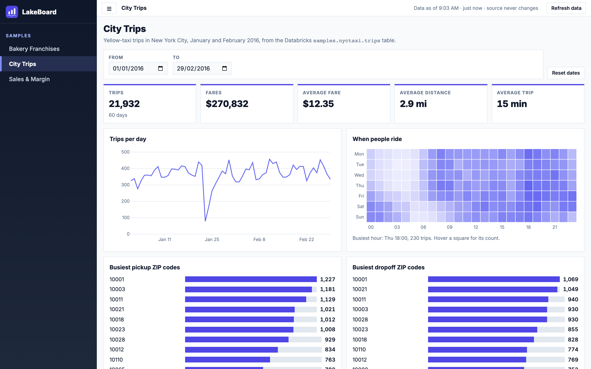
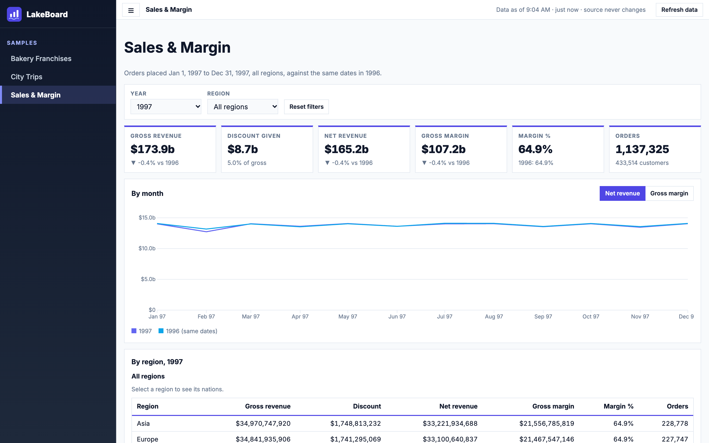
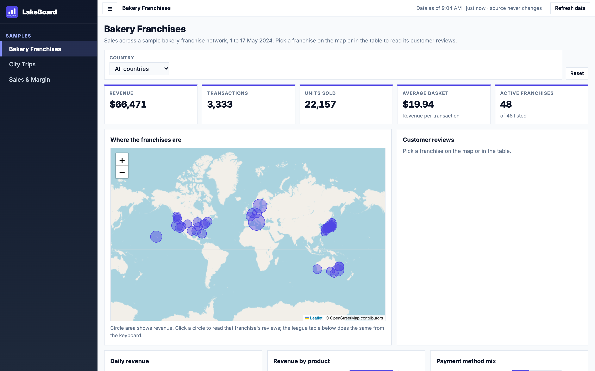
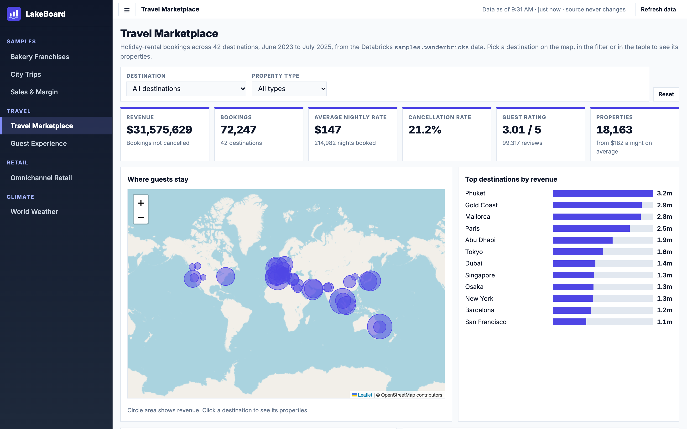
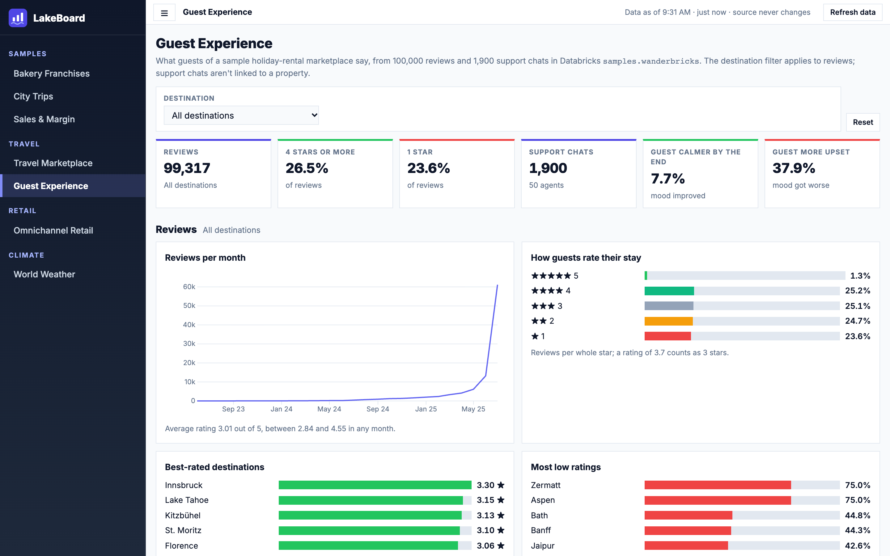
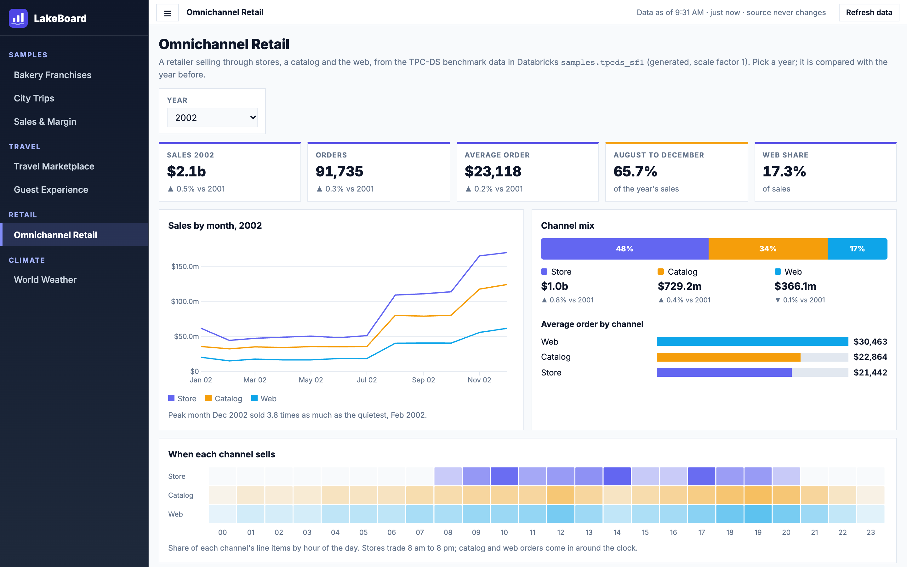
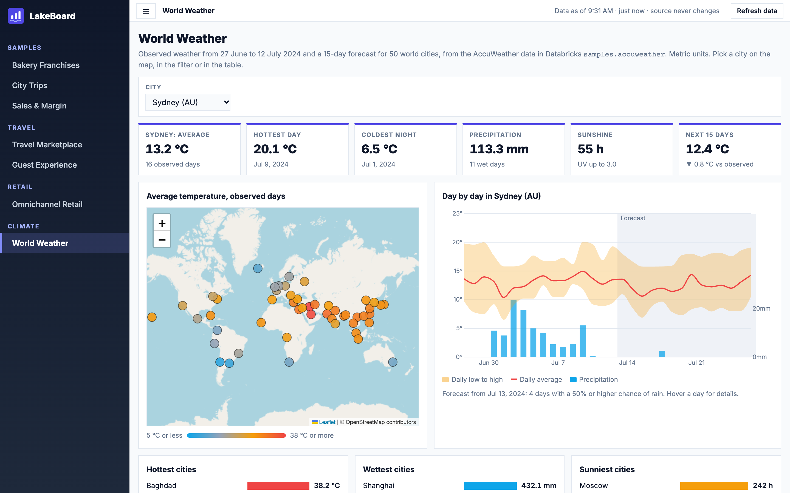

# LakeBoard

**Dashboards on the lakehouse.**

LakeBoard is one Databricks App that hosts many dashboards. Each dashboard is a plain folder under
`src/dashboards/`: a small manifest, a few SQL files and one HTML page. Folders are reviewed by pull request and
deployed to dev, test and prod like any other code. That makes it a practical way to retire Power BI reports one
folder at a time, and it means AI agents such as Claude can write a whole dashboard, because there is nothing to
click through. Queries run as the person viewing the page, so Unity Catalog permissions, row filters and column
masks apply as they are. Every page shows how fresh its data is, and a dashboard can add an "Ask Genie" bar that
answers questions with the viewer's own access.



## Quickstart (about 10 minutes)

This runs the seven sample dashboards, which read only the built-in `samples` catalog. `samples` exists in most
Unity Catalog workspaces (an admin can hide it). [Databricks Free Edition](https://www.databricks.com/learn/free-edition)
works well: it has a serverless starter warehouse, Databricks Apps and the `samples` catalog.

| Sample | Reads | Shows |
|---|---|---|
| [City Trips](src/dashboards/city-trips/) | `samples.nyctaxi` | Taxi trips by day and hour, busy ZIP codes, fares by distance |
| [Sales & Margin](src/dashboards/sales-margin/) | `samples.tpch` | Revenue, discount and margin, year on year |
| [Bakery Franchises](src/dashboards/bakery-franchises/) | `samples.bakehouse` | Franchise sales, products and reviews, on a map |
| [Travel Marketplace](src/dashboards/travel-marketplace/) | `samples.wanderbricks` | Bookings, revenue and seasonality across 42 destinations, drilling down to each property on a map |
| [Guest Experience](src/dashboards/guest-experience/) | `samples.wanderbricks` | Reviews and support chats: ratings, topics, how the guest's mood changes, agents |
| [Omnichannel Retail](src/dashboards/omnichannel-retail/) | `samples.tpcds_sf1` | Store, catalog and web sales year on year, the holiday peak, hours, returns |
| [World Weather](src/dashboards/world-weather/) | `samples.accuweather` | Observed weather and a 15-day forecast for 50 cities, on a temperature map |

<p>
  
  
</p>
<p>
  
  
  
  
</p>

**1. Sign in with the Databricks CLI** (a recent version; `databricks --version`):

```bash
databricks auth login --host https://<your-workspace-host> --profile <cli-profile>
```

**2. Install and run locally.** You need Python 3.11 or later and a SQL warehouse id (SQL Warehouses > your
warehouse > Connection details; on Free Edition, the Serverless Starter Warehouse).

```bash
pip install -r src/requirements.txt fastapi uvicorn pytest httpx
./scripts/run_local.sh <cli-profile> <warehouse-id>
# Windows: ./scripts/run_local.ps1 -Profile <cli-profile> -Warehouse <warehouse-id>
```

Open http://localhost:8000. You are signed in as your CLI profile, and the queries run as you.

**3. Deploy to your workspace.** In `databricks.yml`, set the `dev` target's `host` and `warehouse_id`, and set
`viewers_group` to a group you are in (or `users`). Set the same host for `dev` in `src/environments.yml`. Then:

```bash
databricks bundle deploy -t dev -p <cli-profile>
databricks bundle run portal -t dev -p <cli-profile>
```

The second command prints the app URL. Stop the app when you are done (`databricks apps stop lakeboard-dev
-p <cli-profile>`) so it doesn't use compute.

**Keep your workspace out of git** (optional, handy for a public fork): leave the placeholders and put your values in
two gitignored files instead. `databricks.local.yml` overrides the target:

```yaml
targets:
  dev:
    workspace: {host: https://<your-workspace-host>}
    variables: {warehouse_id: "<warehouse-id>", viewers_group: users}
```

and `src/environments.local.yml` sets the host the app uses to know it is dev:
`environments: {dev: {host: <your-workspace-host>}}` (no https://).

**4. Add your own dashboard:**

```bash
python scripts/new_dashboard.py my-dashboard "My dashboard" --owner Finance --section Finance
python scripts/check.py --static && python -m pytest -q
```

Add your catalogs under `catalogs:` in `src/environments.yml`, then follow [docs/AUTHORING.md](docs/AUTHORING.md).
To hide the samples, delete their folders or set `environments: [dev]` in their `dashboard.yml`.

## Features

- **One app, many dashboards.** One Databricks App (FastAPI) and one deploy, a left navigation with sections, and a
  home page of tiles. A new dashboard costs a folder, not another app.
- **Queries run as the viewer** through Databricks Apps user authorization, so Unity Catalog decides what each person
  sees. Dashboards and single datasets can also be limited to workspace groups.
- **Safe SQL by construction.** One read-only `SELECT`/`WITH` per file, typed `:name` parameters, an allow-list of
  catalogs, and a check that runs on every pull request.
- **Dev, test and prod from one branch flow.** SQL is written with prod catalog names and swapped per environment
  (`src/environments.yml`). Example pipelines for GitHub Actions and Azure DevOps.
- **Caching that fits the data.** Per-viewer or shared results, a time-to-live per dataset, background warming at set
  times, and datasets read as the app for people who have no access to the source.
- **Freshness label.** "Data as of 10:42 am" in the title bar, with a panel showing how each dataset is cached and
  whether the source tables have changed since (from Unity Catalog metadata).
- **Ask Genie** about a dashboard, with the page's filters sent as context. Answers show the table and the SQL.
- **A page kit** (`kit`): filters, KPI tiles, sortable tables with CSV and Excel export, bars, lines, maps, number
  formats. Light and dark themes from one block of CSS variables; the name, logo and locale are configuration.
- **Strict browser sandbox.** A Content-Security-Policy keeps pages from loading or sending anything to other sites.
- **Migration helpers.** A Power BI usage report (who views what) to plan the order of work, and a README template
  for recording how each dashboard reconciles with the report it replaces.

## Why not AI/BI dashboards, Streamlit or Evidence?

They are all good tools, and often the better choice.

- **Databricks AI/BI dashboards** need no code and are built in. Use them when their widgets and layouts are enough.
  LakeBoard is for pages they can't express (custom layouts, maps with routes, drill-downs, printable exports), and
  for teams who want dashboards as reviewed files in git that an agent can write end to end.
- **Streamlit** (or Dash) is Python and great for interactive tools. It is usually one app per dashboard, each with its
  own compute, and every interaction reruns the script on the server. LakeBoard runs one app for all dashboards and
  draws in the browser.
- **Evidence** builds static pages from Markdown and SQL, with the data captured at build time. LakeBoard queries live,
  as each viewer, so row-level security and access changes apply immediately.

The cost of LakeBoard: pages are HTML and JavaScript (or an AI agent writes them), and you own a small platform.

## Limitations

- Databricks only. It needs Databricks Apps and a SQL warehouse, and user authorization for apps must be turned on in
  the workspace (a workspace admin setting).
- Rows reach the browser as strings and are capped (500,000 by default), so aggregate in SQL.
- Caches live in the app's memory: they are lost on restart and not shared between app instances.
- No scheduled emails, subscriptions or alerts; no drag-and-drop editing. Authors write HTML or ask an agent to.
- Ask Genie needs a Genie space you set up; the portal does not create one.
- The freshness label relies on Unity Catalog metadata. External and federated tables have no reliable change time,
  so it says so instead of guessing.
- Background warming and `auth: app` datasets run as the app's service principal, which needs grants
  (`scripts/grant_app_access.py`).

## Documentation

| Document | For |
|---|---|
| [docs/DESIGN.md](docs/DESIGN.md) | How the portal works and why |
| [docs/AUTHORING.md](docs/AUTHORING.md) | Adding a dashboard: the contract, the page kit, the checks |
| [docs/PROMOTION.md](docs/PROMOTION.md) | Moving a change through dev, test and prod |
| [docs/MIGRATION.md](docs/MIGRATION.md) | Moving a report from Power BI, including who uses it today |
| [docs/OPERATIONS.md](docs/OPERATIONS.md) | Access, restricting sections, cost, usage, troubleshooting |
| [docs/decisions/](docs/decisions/README.md) | Decision records: why each feature and design choice was made, and its limits |
| [AGENTS.md](AGENTS.md) | Rules for AI coding tools (Claude Code, Codex, Cursor) working in this repo |
| [CONTRIBUTING.md](CONTRIBUTING.md) | Proposing a change to LakeBoard itself |

## Contributing

Issues and pull requests are welcome. Read [CONTRIBUTING.md](CONTRIBUTING.md) first.

## Licence

Apache License 2.0. See [LICENSE](LICENSE) and [NOTICE](NOTICE).
If you redistribute LakeBoard or a fork of it, keep the NOTICE file.
